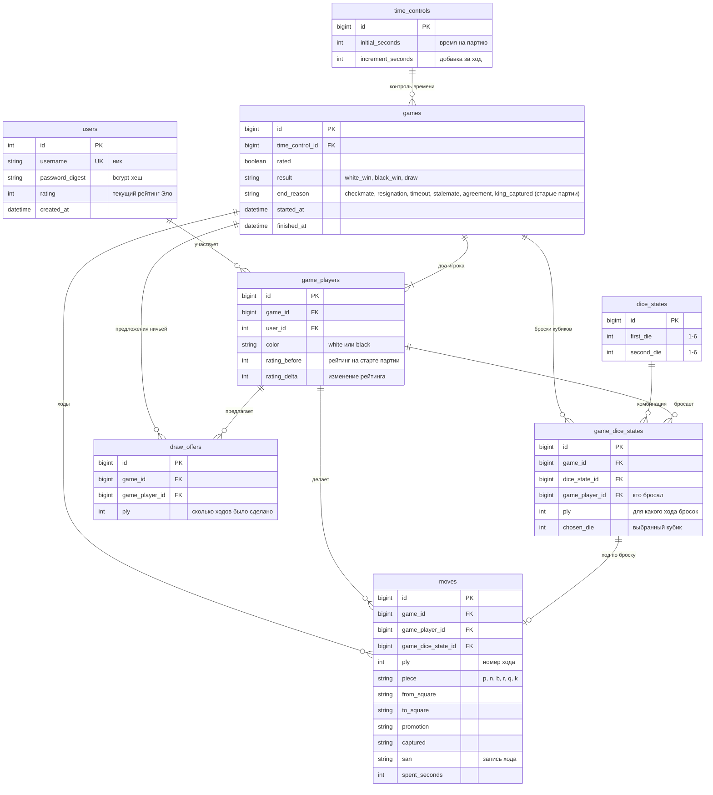

# Схема базы данных

PostgreSQL. Источник правды: миграции в `db/migrate/` и файл `db/schema.rb`.

## ER-диаграмма

## Как это связано со схемой на доске

На рисунке: `Game` — `GameDiceState` — `DiceStates`. В проекте это таблицы `games`, `game_dice_states` и `dice_states`.

- `dice_states` хранит каждую комбинацию двух кубиков один раз (`id`, `first_die`, `second_die`; на рисунке `p1_dice` и `p2_dice`).
  Оба кубика бросает один и тот же игрок, поэтому колонки названы по порядку, а не по игрокам.
- `game_dice_states` связывает партию с комбинациями: связь «многие ко многим». У партии много бросков,
  а одна комбинация (например, 3 и 5) встречается во множестве партий и записана в базе один раз.
  В связке ещё хранятся номер хода, игрок, который бросал, и выбранный кубик.

## Что вынесено и что теперь вычисляется

Принцип: в базе лежат только факты (ходы, броски, участники), а всё, что можно получить из них, вычисляется.

| Раньше хранилось | Теперь |
|---|---|
| Позиция в каждом ходе (`fen_after`) и текущая позиция (`games.fen`) | вычисляется повторным проигрыванием ходов (`Position.replay`) |
| Чья очередь (`games.turn`) | вычисляется по числу сделанных ходов |
| Остаток времени (`white_seconds_left`, `black_seconds_left`) | считается по затраченному на ходы времени и добавке |
| Текущие кубики в партии (`dice_a`, `dice_b`, `chosen_die`) и в ходе (`die_a`, `die_b`, `die_used`) | вынесены в `dice_states` и `game_dice_states` |
| Статус партии (`games.status`) | вычисляется по `started_at` и `finished_at` |
| Кто предложил ничью (`draw_offered_by`) | таблица `draw_offers`, предложение действует, пока не сделан следующий ход |
| Белые и чёрные (`white_player_id`, `black_player_id`) и изменения рейтинга в партии | таблица `game_players`, по строке на игрока |
| Время на партию и добавка в каждой партии | таблица `time_controls`, повторяющиеся значения хранятся один раз |
| Цвет и игрок в каждом ходе | берутся через `game_players` |

Намеренно оставлено сохранённым: `users.rating` (текущий рейтинг, обновляется по итогам партии),
`game_players.rating_before` и `rating_delta` (факт партии), `moves.captured` и `moves.san` (запись хода).

## Целостность на уровне БД

Внешние ключи; уникальные индексы `(game_id, ply)` у ходов и бросков, `(game_id, color)` и `(game_id, user_id)` у игроков,
`(first_die, second_die)` у комбинаций кубиков, `game_dice_state_id` у ходов (один ход на бросок);
проверки допустимых значений (цвет, результат, причина окончания, кубики от 1 до 6, `ply > 0`, время не отрицательное),
`finished_at` и `result` заполнены только вместе, рейтинг не ниже 100.

## Связи в моделях

| Модель | Связи |
|---|---|
| `User` | `has_many :game_players`, `:games` и `:moves` через игрока партии (удаление игрока с партиями запрещено) |
| `Game` | `belongs_to :time_control`, `has_many :game_players`, `:moves`, `:game_dice_states`, `:draw_offers`, `:dice_states` и `:users` через связки |
| `GamePlayer` | `belongs_to :game`, `:user`; `has_many :moves`, `:game_dice_states`, `:draw_offers` |
| `GameDiceState` | `belongs_to :game`, `:dice_state`, `:game_player`; `has_one :move` |
| `DiceState` | `has_many :game_dice_states`, `:games` через них |
| `Move` | `belongs_to :game`, `:game_player`, `:game_dice_state` |
| `TimeControl`, `DrawOffer` | `has_many :games` и `belongs_to :game`, `:game_player` |

## Бизнес-правила

- **Кубики и фигуры.** Игрок бросает два кубика и выбирает значение одного из них. Значение определяет фигуру,
  которой можно ходить: 1 пешка, 2 конь, 3 слон, 4 ладья, 5 ферзь, 6 король (`Game::DICE_PIECES`).
- **Очередь хода.** Бросать кубики, выбирать кубик и ходить может только игрок, чья очередь. Один бросок на ход.
- **Позиция.** Модель `Position` проигрывает ходы с начальной расстановки: взятие, взятие на проходе, рокировка,
  превращение пешки, права на рокировку, счётчики ходов. Ходы фигур считают `Position#moves_from` и `Position#moves_for`:
  пешки (в том числе двойной шаг и взятие на проходе), кони, слоны, ладьи, ферзи, короли и рокировка. Ход записывается,
  только если фигура нужного типа стоит на клетке старта, а клетка назначения входит в её ходы.
- **Шах.** Нельзя оставить свой король под боем, а рокировка запрещена из шаха, через битое поле и на битое поле
  (`Position#in_check?`, `Position#moves_from`).
- **Мат и пат.** После каждого хода проверяется, есть ли у соперника хоть один ход любой фигурой. Нет хода и король под шахом:
  мат (`checkmate`, победа походившего). Нет хода без шаха: пат (`stalemate`, ничья). Причина `king_captured` осталась
  только для старых партий, когда шахи ещё не проверялись.
- **Нет хода по кубикам.** Если ни одной фигурой по значениям кубиков сходить нельзя (например, кубики не помогают выйти
  из шаха), игрок бросает кубики заново (`Game#reroll!`).
- **Отмена.** Создатель партии может отменить её, пока не присоединился соперник (`Game#cancel!`, партия удаляется).
- **Часы.** Остаток времени вычисляется. Если затраченное время не меньше остатка, партия заканчивается поражением по времени.
- **Ничья.** Один игрок предлагает, другой принимает; собственное предложение принять нельзя; следующий ход отменяет предложение.
- **Рейтинг.** В рейтинговой партии по окончании рейтинги меняются по формуле Эло (`EloRating`, K = 32), не ниже 100.
