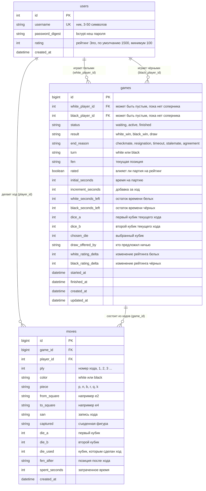

# Схема базы данных

PostgreSQL. Источник правды: миграции в `db/migrate/` и файл `db/schema.rb`.

## ER-диаграмма

## Таблицы

### users
Игроки. Таблица создана ещё первой версией проекта, миграция `CreateUsers` подхватывает уже существующую.
Миграция `AddRatingToUsers` добавляет рейтинг. Ограничения: уникальный ник, `rating >= 100`.

### games
Партия двух игроков. Создатель занимает свободное место (белые или чёрные), второе место пустое, пока соперник
не присоединится (`status = waiting`). Состояние кубиков текущего хода хранится прямо в партии
(`dice_a`, `dice_b`, `chosen_die`) и очищается после хода.

Ограничения на уровне БД: допустимые значения `status`, `turn`, `result`, кубики от 1 до 6,
игрок не может играть сам с собой, остаток времени не отрицательный. Индексы: по `status`,
по `white_player_id` и `black_player_id`.

### moves
Каждый ход партии. Вместе с ходом сохраняются оба выпавших кубика и тот, которым ходили
(`die_used`), позиция после хода и затраченное время. Уникальный индекс `(game_id, ply)` не даёт
записать два хода с одним номером. Проверки: `ply > 0`, `die_used` равен одному из двух кубиков.

## Связи в моделях

| Модель | Связи |
|---|---|
| `User` | `has_many :games_as_white`, `:games_as_black`, `:moves` (удаление игрока с партиями запрещено) |
| `Game` | `belongs_to :white_player`, `:black_player` (оба необязательны), `has_many :moves` (по порядку `ply`, удаляются вместе с партией) |
| `Move` | `belongs_to :game`, `:player` |

## Бизнес-правила

- **Кубики и фигуры.** Игрок бросает два кубика и выбирает значение одного из них. Значение определяет фигуру,
  которой можно ходить: 1 пешка, 2 конь, 3 слон, 4 ладья, 5 ферзь, 6 король (`Game::DICE_PIECES`).
  Ход фигурой, не соответствующей выбранному кубику, не записывается.
- **Очередь хода.** Бросать кубики, выбирать кубик и ходить может только игрок, чья очередь.
- **Часы.** При ходе вычитается затраченное время и добавляется добавка за ход. Если время вышло, партия
  заканчивается поражением по времени, а ход не записывается.
- **Ничья.** Один игрок предлагает, другой принимает; собственное предложение принять нельзя, ход сбрасывает предложение.
- **Рейтинг.** В рейтинговой партии по окончании рейтинги меняются по формуле Эло (`EloRating`, K = 32),
  изменение сохраняется в `white_rating_delta` и `black_rating_delta`. Рейтинг не опускается ниже 100.
- **Статистика игрока.** `User#wins_count`, `#losses_count`, `#draws_count`, `#win_rate` считаются по завершённым партиям.

Правила шахмат (допустимые клетки хода, шах, мат) в моделях пока не проверяются: позицию и запись хода передаёт
игровой движок, а модель следит за очередью, кубиками, временем и результатом.
